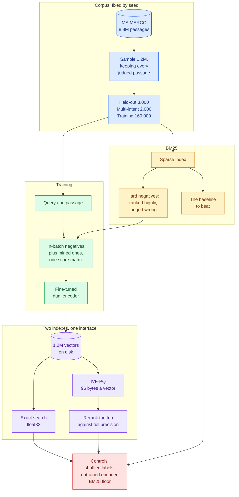

# signalrank

[](https://github.com/rajeev-chaurasia/signalrank/actions/workflows/ci.yml)

A dual encoder trained on mined hard negatives, measured twice: once with exact
search over full-precision vectors, and once with the quantized index that would
actually serve it.

> Fine-tuning a dual encoder on BM25-mined hard negatives retrieves better than
> BM25 over 1.2 million passages, and the improvement survives the quantization
> and approximation needed to answer 100 queries per second.

The first half of that is ordinary. The second half is the part worth testing,
because it is the half that usually fails quietly. Quality is measured with
exact search over float32 vectors; the system ships an approximate index over
vectors compressed thirty-two to one; and nobody measures again. A gain that
becomes a third of itself after product quantization was never the gain that
was reported.

So every quality number here is reported twice, and the same evaluation code
produces both.

The claim, the thresholds and the negative controls were fixed in
[PLAN.md](PLAN.md) and committed before anything was trained, which the history
shows.

## How it fits together



## The decisions that carry it

**The baseline is BM25, not a small sentence encoder.** Most of the obvious
candidates have already been trained on MS MARCO, so using one would measure
contamination rather than improvement. BM25 has seen nothing, and it is strong:
beating it is a real result and failing to beat it would be a real failure.

**Negatives are mined, not sampled.** A random passage teaches a model to
separate a query from an arbitrary document, which it can already do. The
passages BM25 ranks highly and the judgements call wrong are the ones that carry
signal. They are drawn fresh from a pool of eight each time a query is seen, so
a query contributes different near misses across epochs.

**The evaluation cannot tell the two indexes apart.** `FlatIndex` and
`IvfPqIndex` answer the same `search` call, so the difference between their
numbers is the cost of compression and nothing else. Reranking is the dial that
buys some of it back: the compressed codes choose the candidates, the
full-precision vectors decide the order.

**Metrics are written out rather than imported.** Recall here is uncapped, so a
query with more relevant passages than the cut cannot reach 1.0. The capped
definition would score the same run higher. Which one is in use is the
difference between a number that reproduces and one that does not, and
[`core/metrics.py`](src/signalrank/core/metrics.py) is forty lines so it can be
read.

## The negative controls

A retrieval number that goes up is not evidence that anything works, because a
harness with a bug in it produces numbers that go up too. Three controls run on
the same code path as the real evaluation, and
[`script/validate_evidence.py`](script/validate_evidence.py) fails the build if
any of them stops failing:

| control | what it rules out | threshold |
| --- | --- | ---: |
| shuffled labels | the harness finding relevance that is not there | at most 0.01 |
| untrained encoder | the metric being satisfied by something other than the model | at most 0.05 |
| BM25 floor | a win over a baseline too weak to mean anything | at least 0.30 |

The validator also refuses a run where the quantized index scores above exact
search. Both read the same vectors, so that cannot happen, and if it does the
published gap is measuring a bug rather than the cost of compression.

## Results

One training run of `distilbert-base-uncased`, two epochs over 160,000 query
and passage pairs with two mined negatives each, 5,000 steps in 36 minutes on
one L4 in bfloat16. Evaluated on 3,000 held-out queries and the 2,000-query
multi-intent subset, over the 1.2 million passage sample. The quantized index
is IVF-PQ with 4,096 lists and 96 bytes a vector, thirty-two times smaller than
float32, opening 32 lists a query as committed.

Every metric below is recomputed by
[`script/validate_evidence.py`](script/validate_evidence.py) from the rankings
committed under `evidence/runs/`, given the judgements, which MS MARCO's terms
keep out of the repository. CI runs the checks that need no judgements.

### The claim

| threshold, fixed in PLAN.md before the run | committed | measured | |
| --- | ---: | ---: | --- |
| BM25 Recall@20, the baseline | reported | 0.6518 | |
| dual encoder Recall@20, exact search | at least 0.85 | **0.7296** | missed |
| Recall@20 lost to IVF-PQ against exact search | at most 0.03 | **0.0928** | missed |
| NDCG@10 gain from reranking and distillation | at least 0.08 | **+0.0454** | missed |
| IVF-PQ p95 latency at 100 queries a second | at most 190 ms | **3.75 ms** | held |
| training pairs | 160,000 | 160,000 | held |
| shuffled-label Recall@20 | at most 0.01 | **0.0000** | held |
| untrained encoder Recall@20 | at most 0.05 | **0.0082** | held |

The claim does not hold, and the way it fails is the one it was written to
catch. Under exact search the dual encoder beats BM25 by 7.8 points of
Recall@20. Under the quantized index it would actually be served from, as
configured before the run, it scores 0.6368, which is below BM25. The gain was
real in the measurement and gone in the system.

### Exact against quantized

| held-out queries | Recall@20 | Recall@100 | NDCG@10 | MRR@10 |
| --- | ---: | ---: | ---: | ---: |
| BM25 | 0.6518 | 0.7868 | 0.4171 | 0.3704 |
| dual encoder, exact | **0.7296** | **0.8647** | **0.4766** | **0.4259** |
| dual encoder, IVF-PQ, no rerank | 0.6022 | 0.7246 | 0.3830 | 0.3398 |
| dual encoder, IVF-PQ, rerank 4x | 0.6363 | 0.7404 | 0.4242 | 0.3824 |
| dual encoder, IVF-PQ, rerank 10x | 0.6368 | 0.7416 | 0.4243 | 0.3825 |

| multi-intent queries | Recall@20 | NDCG@10 |
| --- | ---: | ---: |
| BM25 | 0.5130 | 0.3410 |
| dual encoder, exact | **0.5857** | **0.3864** |
| dual encoder, IVF-PQ, rerank 10x | 0.5288 | 0.3562 |

Reranking four times as many candidates against full-precision vectors buys
back 3.4 points. Reranking ten times as many buys back nothing more. That is
the clue to where the loss is: deeper reranking can only rescue a passage the
index returned, so whatever is still missing was never returned at all.

### Tracing the quantization loss

The index cuts the corpus into 4,096 lists and opens 32 of them a query, under
one percent. A relevant passage filed in a list that is not opened cannot be
found however its compressed code scores. So the sweep below rebuilds the same
index, holds the rerank at ten times, and opens more lists. It was run after the
miss above, to explain it, and its row at 32 reproduces the published numbers
exactly, which the validator requires.

| lists opened | Recall@20 | lost against exact | Recall@100 | p95 latency |
| ---: | ---: | ---: | ---: | ---: |
| 32 | 0.6368 | 0.0928 | 0.7416 | 8.9 ms |
| 64 | 0.6760 | 0.0536 | 0.7910 | 4.8 ms |
| 128 | 0.6998 | **0.0298** | 0.8218 | 13.2 ms |
| 256 | 0.7093 | 0.0203 | 0.8344 | 18.9 ms |
| 512 | 0.7193 | 0.0103 | 0.8468 | 51.7 ms |

Recall climbs toward exact search as lists are opened, and the loss falls by
nine tenths by 512. The cost was in the coarse partition, not in the
compression. At 128 lists the loss is inside the committed 0.03, at a p95 well
under the latency budget. That setting was chosen after seeing the result, so
it is published as what the sweep found and not counted as the threshold being
met.

The latency column comes from ten-second windows and is noisy: the same setting
measured 3.75 ms over thirty seconds in the main run and 8.9 ms here, where it
ran first, straight after the index was built. Read it for its trend.

### The controls

The shuffled-label control scores exactly zero, and the untrained encoder
scores 0.0082 against the 0.05 ceiling, so the metric is not rewarding
something other than a trained model. BM25 at 0.6518 is well clear of the 0.30
floor, so beating it would have meant something.

## Reproducing it

The corpus is not committed. MS MARCO is released for non-commercial research
with no redistribution rights granted, so the data is fetched rather than
shipped, and no trained weights are published either.

```bash
uv sync --all-groups
./script/fetch_corpus.sh
uv run signalrank build-corpus
uv run signalrank build-bm25
uv run signalrank bm25-baseline
uv run signalrank mine-negatives
```

The sampling is seeded, and it reproduces exactly: the 1.2 million passage
corpus built on an Apple M4 and on a Linux x86 instance have identical
checksums, down to the byte.

Training needs a GPU. [`script/gcp/`](script/gcp) brings one up, runs the whole
pipeline and tears it down again, with the run duration capped so a hung job
cannot bill overnight.

## Layout

| path | what is in it |
| --- | --- |
| `src/signalrank/core/` | metrics, judgements, controls; standard library, numpy and pydantic only |
| `src/signalrank/corpus/` | reading MS MARCO, sampling, and the splits |
| `src/signalrank/mining/` | BM25, for the baseline and the negatives |
| `src/signalrank/models/` | the encoder, the loss, training, encoding to disk |
| `src/signalrank/index/` | exact and quantized search, and the latency harness |
| `script/` | layer check, prose check, evidence validator, the GPU scripts |
| `evidence/` | summaries and the rankings they were computed from |

Two boundaries are enforced rather than trusted. `core` may not import a model
or an index, so the metrics can be tested against worked examples. And faiss
and torch never share a process: each links its own OpenMP runtime, and two in
one process abort at the first threaded matmul, so encoding ends at a file on
disk and indexing starts from one.
